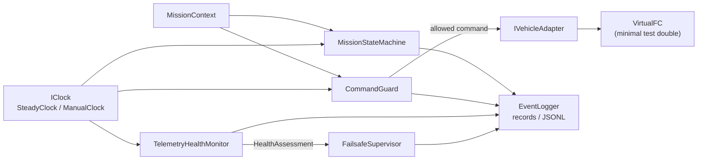

# Fault-Aware Mission Verification for PX4-Based Autonomous UAV Systems

**STATUS: Phase 2 — deterministic health monitoring and failsafe policy**

This repository currently provides a deterministic software framework for expressing and testing high-level UAV mission states and command constraints.

## Research question

Can an explicit mission-state architecture with command validation, telemetry-health monitoring, fault injection, and failsafe supervision make autonomous UAV mission software easier to verify and more robust against realistic mission failures?

Phases 1–2 address whether mission transitions, command constraints, telemetry-health rules, and failsafe decisions can be expressed as small, inspectable, deterministically tested components. They do not provide evidence about flight safety, robustness, real-time behavior, or physical systems.

## Current architecture



The command guard validates commands but never executes them. The vehicle adapter executes already-approved commands but does not define mission transitions. The state machine receives events and does not detect telemetry or faults.

## Implemented and tested

- C++20 mission states, events, context, and explicit transition table
- accepted and rejected transition results with structured reason codes
- high-level command model and state-dependent `CommandGuard`
- `IClock`, production `SteadyClock`, and deterministic `ManualClock`
- minimal synchronous `IVehicleAdapter` and `VirtualFC`
- structured in-memory event records and dependency-free JSONL serialization
- unit and basic integration tests through Catch2 and CTest
- Ubuntu GitHub Actions configuration
- timestamped heartbeat, GPS, position, attitude, battery, ACK, and mission-sync health rules
- explicit `HEALTHY`, `DEGRADED`, `CRITICAL`, and `LOST` classifications
- worst-severity aggregation and configurable healthy-sample hysteresis
- configurable degraded/critical/lost failsafe actions
- explicit coordination tests from health decisions to mission events

The verified runner currently discovers **54 test cases with 126 assertions**. This count reflects the actual Catch2 run, not a target quota.

## Not implemented

- fault injection and scenario configuration
- experiment runner, metrics, results, or plots
- PX4 or MAVLink adapter
- ROS2 nodes
- Gazebo, SITL, HITL, or hardware integration
- flight testing

`VirtualFC` is not a flight simulator. It models only command acknowledgement, arm state, and a small vehicle-mode state.

## Build and test

Requirements:

- CMake 3.20 or newer
- a C++20 compiler
- Git and network access during the first configuration, so CMake can fetch pinned Catch2 v3.8.1

```bash
cmake -S . -B build -DCMAKE_BUILD_TYPE=Debug
cmake --build build --parallel
ctest --test-dir build --output-on-failure
```

No test uses `sleep()` or depends on wall-clock timing.

## Documentation

- [Phase 1 architecture](docs/architecture/phase1-architecture.md)
- [Phase 2 health and failsafe model](docs/architecture/phase2-health-and-failsafe.md)
- [Transition model](docs/research/transition-model.md)
- [Repository audit](docs/research/repository-audit.md)

## Limitations

The mission and health models are intentionally simplified and validated only against deterministic software tests. Health thresholds are configurable experimental assumptions, not validated flight thresholds. Command timeouts, retries, asynchronous transport, flight dynamics, and autopilot behavior remain outside the implemented scope. The transition table and failsafe mapping are research-software models, not aviation safety standards.

## Roadmap

The next proposed phase adds repeatable fault scheduling and external scenario definitions. PX4/ROS2 work remains deferred until the virtual verification framework is stable.
