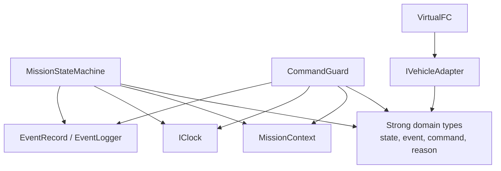
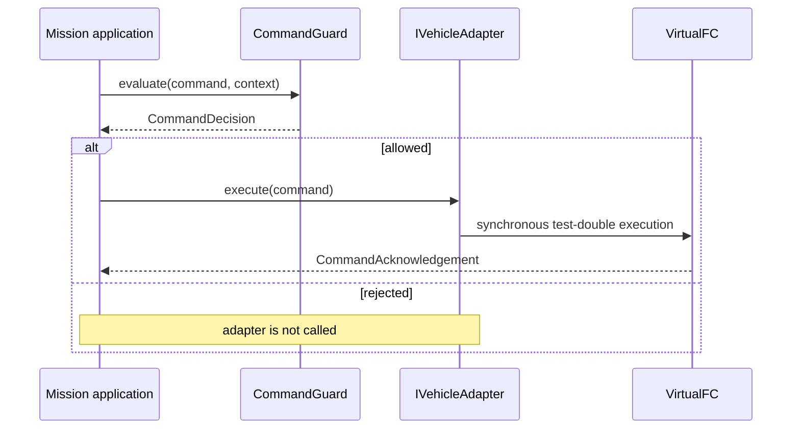

# Phase 1 Architecture

## Purpose

Phase 1 establishes an inspectable mission-software core for deterministic testing. It separates mission semantics, command validation, vehicle execution, time, and evidence records. This phase does not evaluate faults or claim flight-system properties.

## Component responsibilities

| Component | Responsibility | Explicit non-responsibility |
|---|---|---|
| `MissionStateMachine` | validate an event against the transition table, update mission context, return and log the result | detecting faults, executing commands |
| `MissionContext` | hold the small set of high-level facts required by Phase 1 decisions | raw PX4 data, telemetry history, dependency registry |
| `CommandGuard` | decide whether a high-level command is admissible in the current context | executing a command, changing mission state |
| `IVehicleAdapter` | define the narrow synchronous command-execution boundary | mission policy |
| `VirtualFC` | deterministic command ACK/rejection and minimal arm/mode state | flight physics, estimation, control, PX4 emulation |
| `IClock` | supply monotonic time through an explicit boundary | scheduling or threads |
| `EventLogger` | retain structured records and optionally serialize JSONL | policy decisions or full logging framework behavior |

## Dependency direction

Policy code has no PX4, ROS2, network, filesystem, thread, or wall-clock dependency. `SteadyClock` contains the only direct production call to `std::chrono::steady_clock::now()`. Tests use `ManualClock`.

## Command path

The application coordinates these components. This prevents an ACK from automatically becoming a mission transition; a separate, explicit mission event is required.

## Structured records

Mission transitions and command decisions record:

- monotonic millisecond timestamp;
- record kind and sequence;
- previous and next mission state;
- event or command name;
- accepted/rejected flag;
- structured reason code.

JSONL output is dependency-free and intended for later experiment tooling. Phase 1 does not generate result datasets.

## Intentionally unsupported in Phase 1

- telemetry snapshots and health classification;
- timeout/retry scheduling;
- failsafe or recovery-policy selection;
- fault injection or external scenario schemas;
- asynchronous vehicle transport;
- PX4, MAVLink, ROS2, Gazebo, SITL, HITL, or hardware;
- dynamics, position integration, sensor simulation, control loops;
- experiment metrics, plots, or technical-report results.
