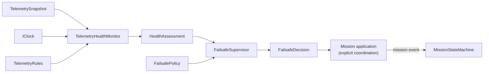

# Phase 2 Health and Failsafe Model

## Scope

Phase 2 adds deterministic telemetry-health classification and configurable mission-level failsafe decisions. It does not inject faults, execute asynchronous recovery procedures, or model PX4 behavior.

The monitor and supervisor never mutate mission state. A caller must translate a decision such as `HOLD` into an explicit mission event.

## Monitored signals

- heartbeat freshness and validity;
- GPS freshness and validity;
- position freshness and validity;
- attitude freshness and validity;
- battery percentage;
- command-acknowledgement freshness and validity;
- mission-synchronization freshness and validity.

Each signal is classified as `HEALTHY`, `DEGRADED`, `CRITICAL`, or `LOST`. The aggregate classification is the highest-severity signal state, making simultaneous-condition precedence deterministic.

## Default experimental thresholds

| Signal | Healthy through | Degraded through | Critical through | Lost |
|---|---:|---:|---:|---:|
| heartbeat | 500 ms | 1,000 ms | 2,000 ms | older/invalid |
| GPS | 1,000 ms | 2,000 ms | 5,000 ms | older/invalid |
| position | 500 ms | 1,000 ms | 2,000 ms | older/invalid |
| attitude | 250 ms | 500 ms | 1,000 ms | older/invalid |
| command ACK | 1,000 ms | 2,000 ms | 5,000 ms | older/invalid |
| mission sync | 1,000 ms | 2,000 ms | 5,000 ms | older/invalid |

Battery defaults are degraded at 30% or lower, critical at 15% or lower, and lost at 5% or lower. “Lost” is a severity label shared by the model; it does not mean battery telemetry is absent.

These values are configurable software-test assumptions. They are not PX4 defaults, hardware limits, or validated flight thresholds.

## Transition behavior

- Health deterioration is applied immediately.
- Recovery from a non-healthy aggregate requires two consecutive fully healthy evaluations by default.
- Any intervening non-healthy evaluation resets the healthy streak.
- No real sleep is used; all age calculations use `IClock`.

## Default failsafe mapping

| Aggregate health | Action |
|---|---|
| `HEALTHY` | `NONE` |
| `DEGRADED` | `HOLD` |
| `CRITICAL` | `RETURN_TO_HOME` |
| `LOST` | `LAND` |

Mappings and the healthy samples required before `RESUME_MISSION` are configurable. The supervisor retains the active action during recovery hysteresis, then emits one `RESUME_MISSION` decision and clears the active action.

## Evidence boundary

Tests demonstrate deterministic classification, precedence, policy selection, logging, and explicit mission coordination. They do not demonstrate that the default policy is safe for a particular aircraft or environment.
