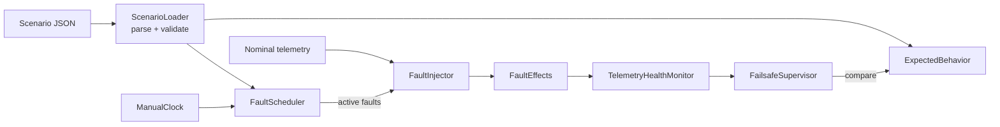

# Phase 3 Fault Model

## Scope

Phase 3 provides repeatable fault definitions, deterministic scheduling, snapshot perturbation, JSON configuration loading, and scenario-level oracles. It does not run statistical experiments or claim that the fault magnitudes represent a particular vehicle or radio.



## Scheduling semantics

A fault is active when:

```text
start <= current_time < start + duration
```

This half-open interval makes activation and clearing boundaries unambiguous. Multiple faults may be active simultaneously. Definitions are stably ordered by activation time, and injection is deterministic for the same definition, seed, sample index, and input snapshot.

## Scenario schema

```json
{
  "schema_version": 1,
  "id": "F03",
  "name": "telemetry_loss",
  "run_duration_ms": 10000,
  "faults": [
    {
      "id": "F03-A",
      "name": "complete telemetry loss",
      "type": "telemetry_loss",
      "severity": "critical",
      "start_ms": 2000,
      "duration_ms": 3000,
      "magnitude": 0,
      "seed": 0
    }
  ],
  "expected": {
    "detection_max_ms": 100,
    "action": "LAND",
    "recovery": true
  }
}
```

`magnitude` and `seed` are optional. Validation rejects unsupported schema versions, missing identifiers, duplicate fault IDs, nonpositive durations, negative start times, and intervals outside the run duration.

## Implemented fault effects

| ID | Type | Deterministic effect |
|---|---|---|
| F01 | telemetry delay | subtract configured age from heartbeat, position, and attitude timestamps |
| F02 | telemetry packet loss | seed/sample-index bucket invalidates heartbeat |
| F03 | telemetry loss | invalidate heartbeat, position, attitude, ACK, and mission sync |
| F04 | GPS degradation | subtract configured age from GPS timestamp |
| F05 | GPS dropout | invalidate GPS |
| F06 | command rejection | set a separate reject-next-command effect |
| F07 | command ACK timeout | invalidate command-ACK signal |
| F08 | mission mismatch | invalidate mission-sync signal |
| F09 | offboard heartbeat loss | invalidate the dedicated offboard-heartbeat signal |
| F10 | critical battery | set configured battery percentage |
| F11 | telemetry and GPS degradation | delay telemetry and invalidate GPS |
| F12 | transient telemetry loss | apply telemetry loss only during the scheduled interval |

The injector changes a copy of its input and does not mutate the nominal source snapshot.

## Oracle boundary

Scenario tests compose the scheduler, injector, Phase 2 health monitor, and Phase 2 supervisor, then compare the decision with the configured expected action. `detection_max_ms` is stored and validated but is not yet measured by a batch experiment runner. F06 is checked as a command effect rather than incorrectly treating command rejection as telemetry loss.

## Limitations

- Packet loss is a deterministic sampling model, not a network emulator.
- No delay queue, threads, MAVLink traffic, or packet transport is modeled.
- Fault severity is descriptive metadata; health classification follows actual injected effects.
- Default magnitudes and expected policies are software-test assumptions.
- No experiment count, detection-latency distribution, or flight result is reported.
